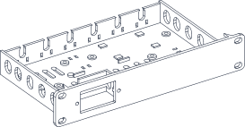

# 10-Inch 1U Rack Low-Voltage DC PDU

A parametric **10-inch 1U rack-mount low-voltage DC Power Distribution Unit (PDU)** cage and faceplate designed in [`build123d`](https://github.com/gumyr/build123d) for support-free flat-bed 3D printing on a **Bambu Lab X1C**.



## Overview & Dimensions

- **Form Factor:** 10" 1U standard (`254.0 mm` W × `140.0 mm` D × `44.45 mm` H)
- **Rack Mounting:** 4× horizontal M6 stadium slots (`236.5 mm` × `31.75 mm` pitch)
- **Internal Mounting:** M3 heat-set threaded inserts (`4.2 mm` bores) + press-fit retaining cradle

## Supported Internal Hardware

1. **AC Inlet (Front-Left):** IEC C14 with fuse & switch (10A 250V, `47.2 × 27.5 mm` cutout, 2× M3 inserts)
2. **12V-to-5V Buck Converter (Middle-Left):** TOBSUN EA50-5V
3. **Smart Energy Meter (Front-Center):** Shelly EM Mini Gen4 (1-Ch 16A) in a recessed press-fit cradle
4. **12V Power Supply (Front/Middle-Right):** NOVBO ECV-036P-012-31 (36W non-dimmable)
5. **5V+ & 12V+ Distribution (Rear-Left / Rear-Right):** 2× 4-position red terminal bus bars
6. **Shared Ground Rail (Center-Rear, Staggered):** 1× 8-position green terminal bus bar

## 3D Printing (Bambu Lab X1C)

Use **`pdu_10inch_1u_x1c.3mf`** to open the ready-to-print project in **Bambu Studio** with the applied slicing settings pre-configured:

- **Printer:** Bambu Lab X1C
- **Build Plate:** Textured PEI Plate
- **Nozzle:** 0.4 mm Hardened Steel
- **Material:** PETG
- **Orientation:** Flat on bed (support-free)

## Repository Files

| File | Description |
| :--- | :--- |
| `pdu_10inch_1u.py` | Parametric `build123d` CAD source script |
| `pdu_10inch_1u_x1c.3mf` | Bambu Studio project file with X1C slicing settings (Textured PEI, 0.4mm hardened nozzle, PETG) |
| `pdu_10inch_1u.3mf` / `.step` / `.stl` | Raw exported 3D CAD / mesh geometry |
| `bambu_x1c_petg_project_settings.json` | Exported Bambu Studio PETG project settings reference |
| `pdu_preview_iso.svg` | Isometric vector preview |
| [`WIRING.md`](WIRING.md) | AC/DC wiring schematic, wire gauges, inline fuse placements, and device connector guide |
| [`pcb/PCB_DESIGN.md`](pcb/PCB_DESIGN.md) | Prototype integrated power PCB (Mean Well IRM-60-12, TI LMR33640 12V→5V 4A buck, fused 12V/5V/GND rails, BOM, KiCad files, 3D STEP & Gerbers) |

## Regenerating CAD Exports

```zsh
.venv/bin/python pdu_10inch_1u.py
```
