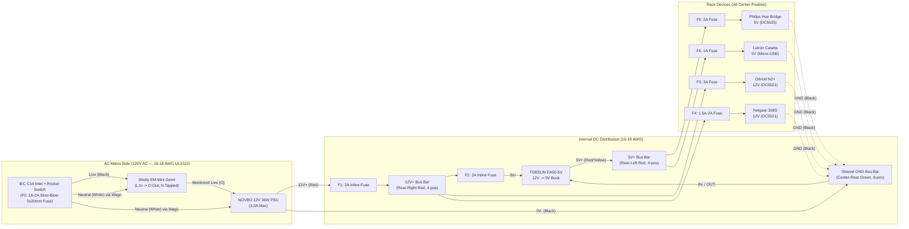

# Wiring Guide — 10-Inch 1U Low-Voltage DC PDU

This guide documents the AC mains wiring, DC rail distribution, recommended wire gauges, inline fuse placements, and connector pinouts for powering the 10" rack devices from this PDU.

> **⚠️ Mains Voltage Warning:** The AC input side carries **120V AC**. Because the PDU enclosure is 3D-printed in PETG, ensure **zero exposed AC copper** anywhere inside the tray (use fully insulated spade disconnects or heat-shrink over IEC C14 rear tabs, bootlace ferrules on screw terminals, and Wago 221 lever nuts for splices). Always unplug the AC cord before working inside the PDU.

---

## Target Rack Devices & Power Budget

**PSU Capacity (`NOVBO ECV-036P-012-31`):** 12V DC, **36W (3.0A max)**  
**Estimated Combined Draw:** ~12–14W typical (~1.1A @ 12V) / ~25–30W peak (~2.3A @ 12V including buck converter loss).

| Device | Rail | Typical / Max Draw | Connector | Polarity |
| :--- | :---: | :---: | :--- | :---: |
| **Odroid N2+** | **12V DC** | ~6W / 2.0A (15–18W peak) | `5.5 × 2.1 mm` male (`DC5521`) | Center `+` |
| **Netgear GS308 / 308S** | **12V DC** | ~3W / 0.5–1.0A | `5.5 × 2.1 mm` male (`DC5521`) | Center `+` |
| **Philips Hue Bridge (v2)** | **5V DC** | ~2W / 1.0A (5W) | `5.5 × 2.5 mm` male (`DC5525`) | Center `+` |
| **Lutron Caséta Bridge** | **5V DC** | ~1.5W / 0.55A (2.8W) | **Micro-USB** male 2-wire pigtail (or barrel-to-Micro-USB adapter) | Pin 1 `+5V` (Red), Pin 5 `GND` (Black) |

> **Connector Note:** Do not use `5.5 × 2.5 mm` (`DC5525`) plugs on the `5.5 × 2.1 mm` (`DC5521`) jacks (Odroid N2+ and Netgear 308S)—the oversized center bore makes loose contact and can cause intermittent reboots.

---

## Wiring Schematic

---

## Recommended Wire Gauges & Terminations

| Segment | Recommended Gauge | Insulation / Spec | Recommended Terminations |
| :--- | :---: | :--- | :--- |
| **AC Mains** (IEC → Shelly → NOVBO PSU) | **16 AWG** or **18 AWG** | Stranded copper, **UL 1015** (600V, 105°C). Black = Live, White = Neutral, Green = Earth | Fully insulated female spade disconnects (IEC tabs) + **Wago 221-413** lever nut for Neutral split + bootlace ferrules |
| **12V Primary** (NOVBO PSU → 12V+ & GND Bus Bars) | **16 AWG** | Silicone or UL 1015 stranded (Red = `+12V`, Black = `GND`) | Insulated **#8 / M4 fork or ring crimp terminals** at bus bars |
| **Buck Feed & Output** (Bus Bars ↔ TOBSUN EA50-5V) | **16 AWG** or **18 AWG** | Stranded (Red = `+12V`, Yellow/Orange = `+5V`, Black = `GND`) | Bootlace ferrules at buck terminals, fork/ring lugs at bus bars |
| **Device Pigtails** (Bus Bars → Devices) | **18 AWG** (14–20 AWG OK) | Red = `+`, Black = `-` | Fork/ring lugs at bus bars; crimp butt-splices or solder + heat-shrink to inline fuse holders |

---

## Inline Fuse Placements & Ratings

Install **inline ATC/ATO mini-blade fuse holders** on every positive (`+`) lead as close to the source / bus bar as practical:

| ID | Location | Rating & Type | Purpose |
| :---: | :--- | :--- | :--- |
| **F0** | Inside IEC C14 Inlet holder | **1A or 2A Slow-Blow (T)** 250V 5×20mm glass | Replaces the stock 10A fuse so the AC side trips on a PSU fault |
| **F1** | NOVBO `12V+` → 12V+ Bus Bar | **3A (or 4A)** Fast-blow blade | Protects the 36W PSU and main 12V rail wiring |
| **F2** | 12V+ Bus Bar → Buck `IN+` | **2A** Fast-blow blade | Protects the 12V feed into the TOBSUN buck converter |
| **F3** | 12V+ Bus Bar → Odroid N2+ | **3A** Fast-blow blade | Protects Odroid N2+ lead (`5.5 × 2.1 mm`) |
| **F4** | 12V+ Bus Bar → Netgear 308S | **1.5A or 2A** Fast-blow blade | Protects Netgear switch lead (`5.5 × 2.1 mm`) |
| **F5** | 5V+ Bus Bar → Philips Hue | **2A** Fast-blow blade | Protects Hue Bridge lead (`5.5 × 2.5 mm`) from the buck's 10A short-circuit capability |
| **F6** | 5V+ Bus Bar → Lutron Caséta | **1A** Fast-blow blade | Protects thin Micro-USB lead from the buck's 10A short-circuit capability |

---

## Pre-Power Assembly & Verification Checklist

1. **AC Switch Ordering:** Wire AC Live (Black) through **IEC Fuse → Rocker Switch → Shelly `L` → Shelly `O` → NOVBO `L`** so the front switch de-energizes everything inside the tray.
2. **Common Ground Continuity Check:** Before powering on, verify with a multimeter in continuity mode that `IN-` and `OUT-` on the TOBSUN EA50-5V share common ground (`~0 Ω`) before tying both to the shared green 8-position GND bus bar.
3. **Label Every Output Plug:** Clearly label every pigtail near the device connector (`12V - ODROID`, `12V - NETGEAR`, `5V - HUE`, `5V - LUTRON`) so a 12V plug is never accidentally inserted into a 5V bridge.
4. **No-Load Voltage & Polarity Test:** Power on with all devices disconnected and verify with a multimeter:
   - **12V+ Bus Bar to GND:** `~12.0V DC`
   - **5V+ Bus Bar to GND:** `~5.0V DC`
   - **Each barrel plug:** Center pin = `+`, outer sleeve = `-`, matching the labeled voltage.
