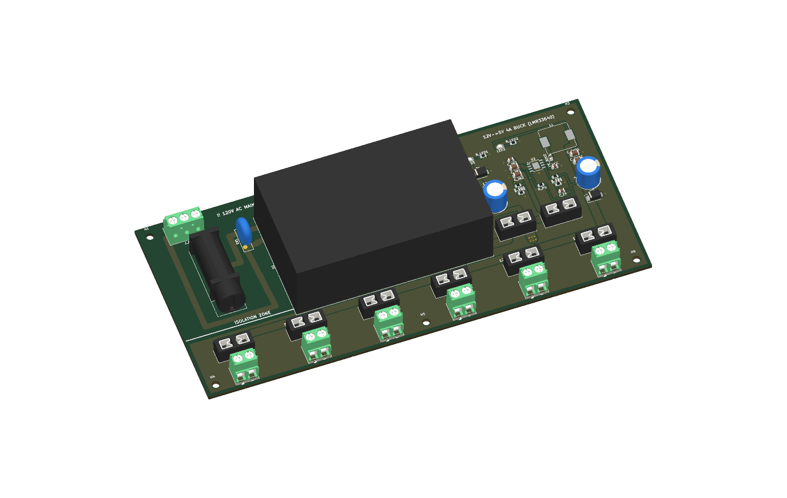
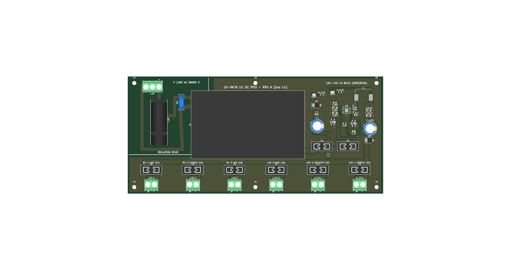

# Prototype Integrated Power PCB — 10-Inch 1U Rack DC PDU (Rev A)

This prototype PCB replaces all discrete internal power distribution hardware from the off-the-shelf build (`NOVBO ECV-036P-012-31` 12V PSU, `TOBSUN EA50-5V` buck converter, 2× 4-position red bus bars, 1× 8-position green GND bus bar, and 6× inline blade fuse holders) with a single **196.0 × 90.0 mm, 2-layer, 2 oz copper** board that fits inside the 10-inch 1U rack tray behind the front IEC C14 inlet and Shelly EM Mini Gen4.

---

## 1. Architecture & Safety Highlights

- **120V AC Primary Input (Isolated Zone, Left-Front):**
  - **10.0 mm L–N input pitch** via a 3-pin 5.0 mm Phoenix terminal block (`J_AC`) with center pin omitted (`Pin 1 = AC_L`, `Pin 2 = NC`, `Pin 3 = AC_N`).
  - Integrated **Bulgin FX0457** enclosed 5×20 mm fuse holder (`F_AC`, **2A Slow-Blow 250V**) and **S14K150 MOV** surge suppressor (`RV1`).
  - Strict copper keepout: **≥ 8.0 mm creepage/clearance** between all 120V AC primary copper and the DC secondary ground planes (marked on silkscreen as `ISOLATION ZONE`).
- **12V AC-DC Power Supply (`U1`):**
  - **Mean Well IRM-60-12** (60W, 12V @ 5.0A) — pin-compatible with **Mean Well IRM-45-12** (45W, 12V @ 3.75A).
  - UL/TUV/IEC 62368-1 certified Class II encapsulated module with **4 kVAC reinforced isolation** and **29.5 mm** body height (clears 1U 44.45 mm envelope by > 5 mm on 4.5 mm standoffs).
- **12V → 5V Synchronous Buck Converter (`U2`):**
  - **TI LMR33640ADDA** (36V, **4.0A**, 400 kHz synchronous buck, HSOP-8-1EP with thermal vias, >94% efficiency).
  - Protected on input by `F2` (2A mini-blade) and precision 9.3V UVLO (`R_EN1`/`R_EN2`); paired with a **Bourns SRP1245A-100M** (10 µH, 8.5A RMS / 14A I_sat, 18 mΩ DCR) shielded inductor, low-ESR MLCC + 470 µF bulk filtering, and `SMBJ5.8A` OVP TVS diode.
- **Integrated Fuse Sockets & Shared Ground Plane:**
  - **8× Keystone 3568** PCB-mount Mini-Blade (ATM/APM) fuse sockets (`F1` main 12V, `F2` buck feed, `F3`–`F8` per-port output fuses).
  - **6× Phoenix Contact PT 1,5/2-5.0-H** (17.5A, 250V) 2-pin screw terminals along the rear edge aligned directly with the 6 rear bulkhead exit ports (`X = -80, -48, -16, +16, +48, +80 mm`).
  - Solid **2 oz (70 µm) shared GND plane** on `B.Cu` + stitched `F.Cu` pour across the entire DC secondary zone.

---

## 2. IPC-2221 Trace Width & Current Capacity (2 oz Copper, ΔT ≤ 10°C)

| Net / Rail | Max Load / Fuse | IPC-2221 Min Width (2 oz, ΔT=10°C) | Designed Trace Width | Rated Capacity (2 oz, ΔT=10°C) | Safety Margin |
| :--- | :---: | :---: | :---: | :---: | :---: |
| **`AC_L`, `AC_L_FUSED`, `AC_N`** | 0.6A RMS / 2A fuse | 0.39 mm | **2.5 mm** (98 mil) | 7.9 A | **> 3.9×** |
| **`+12V_RAW`** (`U1` → `F1`) | 5.0A max / 4A fuse | 1.39 mm | **4.0 mm** (157 mil) | 11.1 A | **2.2×** |
| **`+12V_BUS`** (Main 12V rail) | 4.0A fuse | 1.02 mm | **4.0 mm** (157 mil) | 11.1 A | **2.8×** |
| **`+12V_BUCK_IN`** (`F2` → `U2`) | 2.0A fuse | 0.39 mm | **1.8 mm** (71 mil) | 6.2 A | **3.1×** |
| **`+5V_BUS`** (`L1` → 5V fuses) | 4.0A max | 1.02 mm | **3.5 mm** (138 mil) | 10.1 A | **2.5×** |
| **`+12V_CH1_ODROID`** (`F3` → `J_12V_1`) | 3.0A fuse | 0.69 mm | **2.5 mm** (98 mil) | 7.9 A | **2.6×** |
| **Other Fused Outputs** (`F4`–`F8`) | 1.0A–2.0A fuse | 0.39 mm | **2.0 mm** (79 mil) | 6.7 A | **> 3.3×** |
| **`GND`** (Shared Return) | 5.0A+ combined | — | **Solid 2 oz Plane (`B.Cu` + `F.Cu`)** | > 20 A | **> 4.0×** |

---

## 3. Integrated Fuse Socket Map

| Ref | Type / Socket | Fuse Rating | Circuit Protected |
| :---: | :--- | :---: | :--- |
| **`F_AC`** | Bulgin FX0457 (5×20 mm Closed) | **2A Slow-Blow (T)** 250V | AC Mains input into `U1` (backs up IEC C14 `F0`) |
| **`F1`** | Keystone 3568 (Mini-Blade) | **4A Fast-Blow** | Main 12V PSU output → `+12V_BUS` |
| **`F2`** | Keystone 3568 (Mini-Blade) | **2A Fast-Blow** | `+12V_BUS` → 12V→5V Buck Converter (`U2`) |
| **`F3`** | Keystone 3568 (Mini-Blade) | **3A Fast-Blow** | `J_12V_1`: **Odroid N2+** (12V, `DC5521`) |
| **`F4`** | Keystone 3568 (Mini-Blade) | **2A Fast-Blow** | `J_12V_2`: **Netgear 308S** (12V, `DC5521`) |
| **`F5`** | Keystone 3568 (Mini-Blade) | **2A Fast-Blow** | `J_5V_1`: **Philips Hue Bridge** (5V, `DC5525`) |
| **`F6`** | Keystone 3568 (Mini-Blade) | **1A Fast-Blow** | `J_5V_2`: **Lutron Caséta** (5V, Micro-USB) |
| **`F7`** | Keystone 3568 (Mini-Blade) | **2A Fast-Blow** | `J_12V_3`: **12V Aux / Spare** |
| **`F8`** | Keystone 3568 (Mini-Blade) | **2A Fast-Blow** | `J_5V_3`: **5V Aux / Spare** |

---

## 4. Bill of Materials (BOM)

| Ref | Qty | Value / Description | Package / Footprint | Recommended MPN |
| :--- | :---: | :--- | :--- | :--- |
| `U1` | 1 | 12V 60W (5A) AC-DC Encapsulated PSU (Class II) | Mean Well IRM-60 THT | `IRM-60-12` (or `IRM-45-12`) |
| `U2` | 1 | 36V 4A 400kHz Synchronous Buck Converter | HSOP-8-1EP (DDA) | `LMR33640ADDAR` (TI) |
| `L1` | 1 | 10 µH Shielded Power Inductor, 8.5A RMS / 14A I_sat | 12.5 × 12.5 mm SMD | `SRP1245A-100M` (Bourns) |
| `F_AC` | 1 | 5×20 mm Horizontal Enclosed PCB Fuse Holder | Bulgin FX0457 THT | `FX0457` (Bulgin) |
| `F1`–`F8` | 8 | Mini-Blade (ATM/APM) PCB Fuse Socket | Keystone 3568 THT | `3568` (Keystone) |
| `J_AC` | 1 | 3-Pos 5.0 mm Screw Terminal (center NC = 10mm L–N) | Phoenix PT-1,5-3-5.0-H | `1935174` (Phoenix Contact) |
| `J_5V_1..3`, `J_12V_1..3` | 6 | 2-Pos 5.0 mm Screw Terminal (17.5A, 14–26 AWG) | Phoenix PT-1,5-2-5.0-H | `1935161` (Phoenix Contact) |
| `RV1` | 1 | 150VAC RMS Metal Oxide Varistor (MOV) | Disc D12mm P7.5mm | `B72214S0151K101` (TDK S14K150) |
| `D1` | 1 | 15V Unidirectional TVS Diode (600W) | SMB (DO-214AA) | `SMBJ15A` (Littelfuse) |
| `D2` | 1 | 5.8V Unidirectional TVS Diode (600W) | SMB (DO-214AA) | `SMBJ5.8A` (Littelfuse) |
| `C1` | 1 | 470 µF 25V Low-ESR Electrolytic Cap | Radial D10mm P5mm | `EEU-FR1E471` (Panasonic) |
| `C_OUT3` | 1 | 470 µF 16V Low-ESR Electrolytic Cap | Radial D10mm P5mm | `EEU-FR1C471` (Panasonic) |
| `C_IN1` | 1 | 22 µF 25V X5R Ceramic Cap | 1206 SMD | `CL31A226KAHNNNE` |
| `C_IN2` | 1 | 10 µF 25V X5R Ceramic Cap | 1206 SMD | `CL31A106KAHNNNE` |
| `C_OUT1`, `C_OUT2` | 2 | 47 µF 10V X5R Ceramic Cap | 1206 SMD | `CL31A476MPHNNNE` |
| `C_VCC` | 1 | 1 µF 16V X7R Ceramic Cap | 0805 SMD | Standard 0805 1µF X7R |
| `C2`, `C_IN3`, `C_BOOT` | 3 | 100 nF 25V X7R Ceramic Cap | 0805 SMD | Standard 0805 100nF X7R |
| `C_FF` | 1 | 22 pF 50V C0G Ceramic Cap | 0805 SMD | Standard 0805 22pF C0G |
| `R_FB1`, `R_EN1`, `R_PG` | 3 | 100 kΩ 1% Resistor | 0805 SMD | Standard 0805 100k 1% |
| `R_FB2` | 1 | 24.9 kΩ 1% Resistor (`Vout = 5.016V`) | 0805 SMD | Standard 0805 24.9k 1% |
| `R_EN2` | 1 | 15 kΩ 1% Resistor (9.3V UVLO) | 0805 SMD | Standard 0805 15k 1% |
| `R_LED1` | 1 | 2.2 kΩ Resistor | 0805 SMD | Standard 0805 2.2k |
| `R_LED2` | 1 | 1.0 kΩ Resistor | 0805 SMD | Standard 0805 1.0k |
| `LED1`, `LED2` | 2 | Green Power-OK Indicator LED | 0805 SMD | `LTST-C170KGKT` |

---

## 5. Fabrication Specifications (JLCPCB / PCBWay)

- **Layers:** 2-layer FR-4 (`Tg150` or `Tg170`)
- **Board Size:** `196.0 × 90.0 mm`
- **Board Thickness:** `1.6 mm`
- **Copper Weight:** **2 oz (70 µm)** outer copper (critical for IPC-2221 power ratings)
- **Surface Finish:** Lead-Free HASL or ENIG
- **Gerbers & Drill Files:** Ready to zip in [`gerbers/`](gerbers/)
- **DRC Status:** **0 errors, 0 unconnected nets** (verified via KiCad 10 `kicad-cli pcb drc`).

---

## 6. Mechanical Integration in 10" 1U Rack Tray

- Mounts on **6× M3 × 4.5 mm brass standoffs** (`H1`–`H6`, 3.2 mm non-plated holes) inside the 10" 1U tray at `X ∈ [-98, +98]`, `Y ∈ [41, 131]`.
- Keep the front `Y ∈ [4, 38]` corridor dedicated to the **IEC C14 Inlet** (Front-Left) and **Shelly EM Mini Gen4** (Front-Center) so all 120V AC wiring enters `J_AC` directly at the front-left of the PCB.
- The 6 rear Phoenix terminals align directly with the 6 rear bulkhead pass-through slots (`X = -80, -48, -16, +16, +48, +80 mm`).
